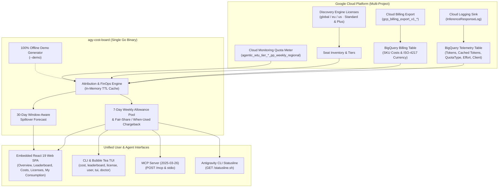

# `agy-cost-board` Documentation Hub

Welcome to the official documentation for **`agy-cost-board`**—the enterprise-grade AI FinOps engine, Weekly Allowance Pool simulator, and developer telemetry board for **Google Antigravity** and **Gemini Enterprise**.

`agy-cost-board` reconciles real-time BigQuery inference logs (`InferenceResponseLog`) with Google Cloud Billing exports (`gcp_billing_export_v1_*`) and Cloud Monitoring quota meters (`agentic_wtu_tier_*_pp_weekly_regional`), providing exact per-developer cost attribution, Weighted Token Unit (WTU) weekly pool governance, 30-day spillover forecasting, and shelfware license reclamation in a single static binary.

---

## 📚 Documentation Index

| Guide | Topics Covered |
| :--- | :--- |
| [**Getting Started & GCP Setup**](./getting-started.md) | Building from source, running the 100% offline Synthetic Demo Lab (`--demo`), and connecting to Google Cloud & BigQuery using the 5-point diagnostic & provisioning engine (`setup`, `setup --create`, `setup --save`, `doctor`). |
| [**Architecture & FinOps Model**](./architecture-and-finops.md) | Mathematical Proportional Attribution (`Allocated Cost(u, m, d)`), Weighted Token Units (WTU), Floating 7-Day Weekly Allowance Pools (`Standard` & `Plus` tiers), Fair-Share vs. When-Used PAYG Chargeback, 30-Day Window-Aware Forecast, Cloud Monitoring Quota Meter reconciliation, Token Cache Hit Rate, Thinking Effort (`minimal`..`max`), Client Telemetry, Shelfware Reclamation, and Native ISO-4217 Multi-Currency. |
| [**Interfaces, CLI & API Reference**](./interfaces-and-reference.md) | Web Dashboard guide (two-line navigation, multi-project selector, What-If pool controls, CSV chargeback export, "What's New" & "MCP & Quotas" modals), Interactive TUI (`agy-cost-board tui`), complete CLI Command Reference, and REST API Reference. |
| [**Integrations: MCP Server, Plugin & Statusline**](./integrations.md) | Model Context Protocol (`2025-03-26`) Server (Streamable HTTP `POST /mcp` & `stdio`), exposed FinOps tools, `.agents/plugins/agy-cost-board/` Antigravity plugin, and the fail-open Antigravity CLI Statusline script (`GET /statusline.sh`). |
| [**Cloud Run Deployment & Configuration**](./deployment.md) | One-click Cloud Run deployment (`app.json`), declarative Knative Service (`deploy.yaml`), manual `gcloud` deployment, IAM / IAP security, multi-project configuration (`--monitored-projects`), and complete `AGY_COST_BOARD_*` environment variable & `.agy-cost-board.yaml` reference. |

---

## 🧭 Persona-Based Reading Paths

### 1. Platform & FinOps Engineers
1. Start with [**Getting Started & GCP Setup**](./getting-started.md) to verify IAM permissions, BigQuery datasets, and Cloud Logging sinks via `agy-cost-board setup`.
2. Read [**Architecture & FinOps Model**](./architecture-and-finops.md) to understand how Cloud Billing reconciliation, Weekly Allowance Pools (`Standard` `$2.50/wk` vs. `Plus` `$3.75/wk`), **Fair-Share vs. When-Used** PAYG chargeback, and Cloud Monitoring quota meter drift detection work.
3. Follow [**Cloud Run Deployment & Configuration**](./deployment.md) to deploy `agy-cost-board` across one or multiple GCP projects (`AGY_COST_BOARD_MONITORED_PROJECTS`).

### 2. Engineering Managers & FinOps Leads
1. Explore the Web UI and CLI in [**Interfaces, CLI & API Reference**](./interfaces-and-reference.md) to inspect the **Overview**, **Developer Leaderboard**, **Attributed Costs** (with CSV export), and **Seat Governance** tabs.
2. Review [**Architecture & FinOps Model**](./architecture-and-finops.md) to evaluate **Pooled vs. Per-User** and **Purchased vs. Assigned** What-If pool simulations, 30-day PAYG spillover forecasts, and dormant seat reclamation (`$45/seat/month`).

### 3. Developers & AI Agent Authors
1. Set up real-time terminal spend visibility (`· cost €18` / `· cost $18`) and the Antigravity MCP plugin using [**Integrations: MCP Server, Plugin & Statusline**](./integrations.md).
2. Use the **My Consumption** self-service tab documented in [**Interfaces, CLI & API Reference**](./interfaces-and-reference.md) to track personal burn rate, monthly budget pacing, prompt cache hit rate, and thinking effort efficiency (`minimal` through `max`).

---

## 🏗️ System Architecture Overview

---

## 🔗 Quick Links
- [Main Project README](../README.md)
- [Contributing Guide](../CONTRIBUTING.md)
- [Security Policy](../SECURITY.md)
